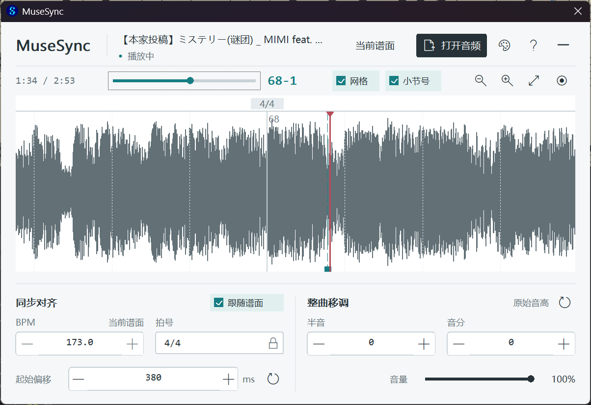

# MuseSync 谱伴同步

看谱、放伴奏，想从哪一小节练，就从哪儿开始。

MuseSync 把伴奏放进 MuseScore 4：载入音频，对齐第一拍，再跟着谱面播放。波形、小节线和播放位置放在同一个窗口里，不用在谱子和播放器之间来回找进度。

它由 Windows VST3 插件和 MuseSync Bridge 两部分配合工作。Bridge 读取谱面的速度、拍号和小节信息，VST3 负责伴奏播放与界面。

维护与定制：**@爱鸽咕子** · [Aigooz](https://github.com/Aigooz)

[下载安装包](https://github.com/Aigooz/MuseSync/releases/latest) · [使用演示](https://github.com/Aigooz/MuseSync/releases/download/v2.2.0/MuseSync-Demo.mp4) · [反馈问题](https://github.com/Aigooz/MuseSync/issues) · [更新记录](CHANGELOG.md)



图中正在第 68 小节第 1 拍，进度条右边的 `68-1` 就是当前位置。下方可以对齐伴奏、调整音高；不需要看波形时，可以收成悬浮条，把空间留给谱子。

**先看一遍怎么用：** [曲谱同步使用演示 · MP4，约 3 分 54 秒](https://github.com/Aigooz/MuseSync/releases/download/v2.2.0/MuseSync-Demo.mp4)。视频约 126 MB，已放在 Releases；链接可能直接下载，下载后可用本地播放器打开。

## 下载

当前版本为 **MuseSync 2.5.2**，搭配 **MuseSync Bridge 1.4.0**。

打开 [Releases 发布页](https://github.com/Aigooz/MuseSync/releases/latest)，下载：

```text
MuseSync-Setup-2.5.2-Windows-x64.exe
```

**自己用，或者发给别人用，都只需要这个 EXE。** VST3、Bridge 和安装说明已经在里面，不用再找源码、SDK 或 ZIP。不过，它安装的是插件，不能单独当播放器用，电脑上还是要有 MuseScore 4。

Windows ZIP 留给需要手动部署的人，Source ZIP 是源码。要核对下载文件，可以用同一发布页里的 `SHA256SUMS.txt`。

2.5.2 停止分析在线视频的素材 BPM，保留本地素材分析。[查看这次更新](docs/RELEASE-2.5.2.md)。

## 可以做什么

**先把伴奏和谱子对上。** 打开 MP3、WAV 等音频后，可以直接看波形，让伴奏跟随 MuseScore 播放。Bridge 会读取谱面的速度、拍号及中途变化，波形上的小节网格方便对照播放头。伴奏开头有一段空白，也不用先剪掉，调整“起始偏移”就能对齐第一拍。

**练到哪里，一眼能找到。** 进度条显示播放位置，也可以通过 Bridge 请求跳转到谱面位置。旁边的 `73-3` 表示第 73 小节、第 3 拍。窗口挡谱时就收起来，悬浮条仍显示小节与拍数，需要调整时再展开。

**换个调，不改伴奏长度。** 半音和音分可以分别调整，变调后总时长不变。界面也可以换主题，使用指南和关于信息放在右上角的“？”里。

有一点要分清：**跟随谱面不等于自动变速。** 谱子中途换速度时，同步网格会读取相应信息，但 MuseSync 不会把录好的伴奏自动拉长或压短。音频本身仍需要与谱面的演奏安排一致。

## 安装与启用

1. 保存谱面，退出 MuseScore 和其他正在使用插件的宿主。
2. 运行 EXE 安装器，按提示授予管理员权限。
3. 选择 MuseScore 4 的安装文件夹，例如 `D:\MuseScore 4`，其中应包含 `bin\MuseScore4.exe`。不要选择存放谱面的文件夹。
4. 安装完成后重新打开 MuseScore，在插件管理中启用 **MuseSync Bridge**。
5. 每次启动 MuseScore 后，从插件菜单运行一次 Bridge。看到“已开启”提示就说明它在工作，之后会留在后台。
6. 在混音器中选择 **MuseSync** VST3 音源，保持对应通道未静音，打开面板并载入伴奏。
7. 开启“跟随谱面”，调整起始偏移，对齐伴奏与谱面后开始播放。

安装器还没有代码签名，Windows SmartScreen 可能会提示。请核对下载来源和校验值，按本机安全策略处理，不要为安装插件关闭系统防护。

## 版本兼容

| 环境 | 支持状态 |
| --- | --- |
| Windows 10 / 11 x64 | 当前维护与打包平台 |
| MuseScore 4.7 | 当前主要目标环境 |
| MuseScore 4.6 | 保留新版谱面分段接口路径，仍需实际宿主验证 |
| MuseScore 4.0–4.5 | 已包含旧接口分支，通过接口回归测试，尚未逐版本实机验证 |
| MuseScore 3.x | **不支持**，宿主本身不支持加载 VST3 |
| macOS / Linux | 本仓库当前不提供与 Windows 新版功能对等的安装包 |

通过自动化测试，不代表每个 4.x 补丁版本、每份谱子都已经实机试过。音符之间的速度标记、渐变速度、反复展开和临时播放速度倍率，仍可能让同步出现偏差。

如果电脑里装了几个 MuseScore 4，Bridge 只会装进你在安装向导里选的那一个。换版本使用时，重新运行安装器，选择对应目录。

## 更新

**有新版就下载新 EXE，直接覆盖安装，不用先卸载。** 先保存谱面、退出 MuseScore，再从 [发布页](https://github.com/Aigooz/MuseSync/releases/latest) 下载并运行安装器，装回原位置。

安装器会沿用原来的位置，替换插件和 Bridge，不会覆盖你的谱面、伴奏文件和已有同步 INI。插件参数记得先随谱面保存。如果 MuseScore 已经搬到别的目录，在向导里重新选一次。

从 2.3.0 开始，打开插件面板会后台检查更新，有新版时“？”上会出现提示点。打开指南，点击“检查更新”或“下载更新”，不用跳转浏览器；下载完成并通过 SHA-256 校验后，可以点击“安装更新”。安装前仍需保存谱面并手动退出 MuseScore。

2.2.0 及更早版本没有这个更新入口，第一次升级到 2.3.0 需要手动下载 EXE。连不上 GitHub 时，也可以拿到新版 EXE 后手动安装。

需要卸载时，打开 `C:\Program Files\MuseTone`，双击“一键卸载 MuseSync”快捷方式，即可移除 Bridge 和 VST3，保留谱面、伴奏和同步 INI。也可以从 Windows 设置的应用列表卸载。普通更新不需要先做这一步。

## 常见问题

### 只把 EXE 发给别人就可以吗？

可以。Windows 用户不需要工程文件和 SDK，但仍需安装 MuseScore 4，并在安装后启用 Bridge 与 VST3。

### 装完后为什么没有自动同步？

先看 Bridge：是否在插件管理里启用了？这次打开 MuseScore 后，有没有从菜单运行过？再看 VST3 面板里的“跟随谱面”有没有打开。两个组件要一起工作，只开其中一个还不够。

### 为什么没有声音？

先确认伴奏已经载入、MuseScore 正在播放，再检查插件通道有没有静音、音量是不是太低。按空格没反应时，先点一下谱面，再使用 MuseScore 的播放控制。

### 为什么安装路径里还有 MuseTone？

MuseSync 曾使用 MuseTone 名称。为兼容旧谱面与覆盖升级，部分内部标识和路径保留旧名称，包括 `plugins\MuseToneSync` 与 `C:\Program Files\MuseTone`。不要自行重命名这些目录。

### 怎么反馈问题？

到 [Issues](https://github.com/Aigooz/MuseSync/issues) 留下 Windows、MuseScore 和插件的版本，说清楚做了哪几步、在哪一步出问题，最好附张截图。如果只有某份谱子会出错，可以提供能复现问题的最小示例，先去掉隐私和不便分享的内容。

## 从源码构建

Windows 构建需要 Visual Studio C++ Build Tools、CMake、Git，以及完整的 VST3 SDK 与子模块。发布构建固定使用下列 SDK 提交：

```powershell
git clone https://github.com/Aigooz/MuseSync.git
cd MuseSync
git clone --recurse-submodules https://github.com/steinbergmedia/vst3sdk.git vst3sdk
git -C vst3sdk checkout 3cdf9ca5d1f5b1b21e0a86832aa4abe55607bd96
git -C vst3sdk submodule update --init --recursive
cmake -S . -B build -A x64 -DMUSETONE_BUILD_TESTS=ON
cmake --build build --config Release --parallel 4
ctest --test-dir build -C Release --output-on-failure
```

Windows 插件产物为 `build/VST3/Release/MuseSync.vst3`。安装 Inno Setup 6 与 PowerShell 7 后可以打包：

```powershell
pwsh -File tools/package-windows.ps1 -BuildDirectory build
```

## 关于与许可

MuseSync 谱伴同步由 **@爱鸽咕子** 维护与定制，GitHub 账号是 [Aigooz](https://github.com/Aigooz)。

项目按 [GPL-3.0](LICENSE) 发布。代码来源、第三方依赖及版权说明见 [第三方声明](THIRD_PARTY_NOTICES.md)，源码中也保留了相应声明。

MuseSync 与 MuseScore、Muse Group 及 Steinberg 无隶属或官方背书关系。相关商标归各自权利人所有。
